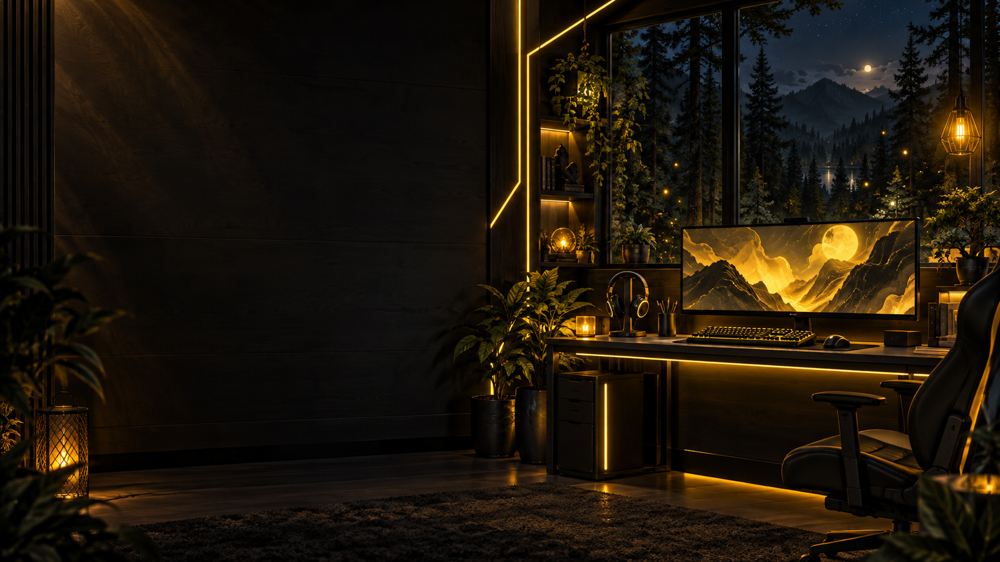

# Hondo.CF — Le terrier de Hondo_27 🦊

Le site personnel de **Hondo_27**, streamer et youtubeur : son univers, ses projets, les rendez-vous Twitch et sa communauté **Honothya**.

**[Visiter le site](https://hondocf.vercel.app/)** · **[Twitch](https://twitch.tv/hondo_27)** · **[YouTube](https://youtube.com/@Hondo_27)** · **[Tous les réseaux](https://guns.lol/hondo_27)**



## L’univers Hondo

Du gaming, du multigaming, Minecraft, R.E.P.O. et des moments partagés avec le chat. La direction artistique reprend l’univers de **Hondo_27 Studio**, créé pour Hondo par son ami **Anth_0ff · Anthony Viani** : un renard roux, un terrier nocturne, un fond sombre, du jaune lumineux et des formes arrondies.

**Pourquoi .CF ?** C est l’initiale de sa sœur et de sa mère ; F est celle de son père et de lui-même. [Lire cette histoire](https://hondocf.vercel.app/a-propos/#le-point-cf).

Hondo.CF est le nom du projet. Son adresse publique actuelle est **hondocf.vercel.app** ; ce dépôt ne revendique pas la possession d’un domaine `hondo.cf`.

## Les pages

| Page | Contenu | Adresse |
| --- | --- | --- |
| Accueil | Présentation, projets, vidéos, planning et réseaux | `/` |
| À propos | Parcours, passions, setup et histoire du .CF | `/a-propos/` |
| Mes projets | Catalogue des deux projets et leurs accès | `/projets/` |
| MineCards TCG | Collection, decks et arène | `/projets/minecards-tcg/` |
| Hondo_27 Studio | Coulisses, scènes et identité des lives | `/projets/hondo-studio/` |
| Les lives | Horaires, prochain rendez-vous et agenda | `/lives/` |
| La meute | Honothya, règles et commandes du renard | `/communaute/` |
| On discute ? | Liens de contact et questions fréquentes | `/contact/` |

Une page **404** personnalisée accompagne les adresses introuvables.

## Les projets présentés

### MineCards TCG

Le **site compagnon de Hondo**, auxiliaire de **Minecards**, créé par Anth_0ff : gérer les cartes obtenues sur Minecards, composer des decks et affronter les autres utilisateurs dans l’arène.

- [MineCards TCG — le compagnon](https://minecards-tcg.vercel.app/)
- [Minecards — le site original d’Anth_0ff](https://minecards.vercel.app/)

Ces deux plateformes sont des services externes. Leur code, leurs comptes et leurs données ne font pas partie de ce dépôt.

### Hondo_27 Studio

Un studio local sur Windows créé pour Hondo par **Anth_0ff / Anthony Viani** : scènes, transitions, overlays, visuels, régie et mascotte. Hondo.CF en présente les coulisses et des aperçus ; ce dépôt ne distribue pas l’application Studio.

- [Le projet raconté par son créateur](https://aviani.sh/projets/hondo-studio/)
- [L’univers d’Anthony Viani](https://aviani.sh/)

## Les rendez-vous Twitch

| Jour | Horaire habituel, heure de Paris |
| --- | --- |
| Mardi | Début entre **20h30 et 21h** |
| Mercredi | Début entre **20h30 et 21h** |
| Jeudi | Début entre **20h30 et 21h** |
| Dimanche | **12h → 00h**, douze heures de live |

Le prochain créneau est calculé dans le fuseau **Europe/Paris**. [L’agenda iCalendar](https://hondocf.vercel.app/hondo-27-planning.ics) contient les quatre rendez-vous récurrents et les règles de changement d’heure.

L’affichage indique des **horaires habituels**, sans interroger l’état réel des lives Twitch. Les changements et annonces se retrouvent sur [Discord Honothya](https://discord.gg/xpTN35HGR4) et [Twitch](https://twitch.tv/hondo_27).

## Fonctionnalités

- Mise en page responsive et navigation mobile.
- Animations d’apparition, lumière au survol des cartes et progression du défilement.
- Réduction des animations selon le réglage système ; bouton pour activer ou suspendre les animations, mémorisé localement.
- Curseur renard jaune sur ordinateur, variante ivoire avec halo jaune sur les liens et boutons ; scrollbar assortie.
- Aperçus des ambiances du Studio et navigation entre les projets.
- Démonstration **illustrative** du renard avec `!reveille`, `!cafe`, `!caresse` et copie de la commande pour le chat Twitch.
- Métadonnées de partage, URL canoniques, sitemap, robots et page 404.
- Images, icônes et polices servies depuis le site.

## Technologies

**HTML · CSS · JavaScript natif · Node.js · Vercel**

Le site est statique. Son build utilise uniquement les modules standard de Node.js : **aucune dépendance npm, aucun backend, aucune base de données et aucune variable d’environnement ne sont nécessaires**.

## Démarrer en local

Prérequis : **Node.js 24 recommandé**, avec npm.

```bash
git clone https://github.com/Hondo277/Hondo.CF.git
cd Hondo.CF
npm run build
```

Les fichiers publiables sont générés dans **`dist/`**. Aucun `npm install` n’est nécessaire avec le projet actuel. Servir ce dossier avec un serveur HTTP statique, par exemple si Python est installé :

```bash
python -m http.server 4173 --directory dist
```

Puis ouvrir **http://localhost:4173**. Utiliser un serveur HTTP pour que les chemins absolus et le module du planning fonctionnent correctement. Après une modification, relancer `npm run build`.

## Déploiement Vercel

Le projet Vercel existant s’appelle **`hondo.cf`**. Sa configuration se trouve dans [`vercel.json`](vercel.json).

| Paramètre | Valeur |
| --- | --- |
| Framework | Other / aucun framework |
| Répertoire racine | Racine du dépôt |
| Commande de build | `npm run build` |
| Répertoire de sortie | `dist` |
| Variables d’environnement requises | Aucune |

Pour utiliser l’intégration Git, connecter ce dépôt dans les paramètres du projet Vercel existant. Publier le code sur GitHub ne suffit pas, à lui seul, à relier les deux services. Le dossier `.vercel/` est une configuration locale ignorée par Git.

Les URL canoniques et de partage utilisent `https://hondocf.vercel.app`. Si cette adresse change, suivre le [guide de maintenance](docs/MAINTENANCE.md).

## Structure du dépôt

```text
Hondo.CF/
├── index.html                # Accueil
├── styles.css                # Base et déclarations des polices
├── favicon.svg
├── pages/                    # Contenu des sept pages et de la page 404
├── public/
│   ├── images/               # Renard, terrier, icônes et curseurs SVG
│   ├── fonts/                # Polices locales et leurs licences
│   ├── refresh.css           # DA, mouvement, curseurs et scrollbar
│   ├── pages.css             # Pages internes et composants
│   ├── planning.js           # Prochain rendez-vous en heure de Paris
│   └── site.js               # Interactions côté navigateur
├── scripts/
│   ├── build.mjs             # Génération de dist/, sitemap, robots et 404
│   ├── layout.mjs            # En-tête, pied de page et métadonnées
│   └── calendar.mjs          # Agenda iCalendar récurrent
├── docs/                     # Maintenance, architecture et références
├── CREDITS.md
├── package.json
└── vercel.json
```

## Documentation et crédits

- [Maintenance et personnalisation](docs/MAINTENANCE.md)
- [Architecture et limites fonctionnelles](docs/ARCHITECTURE.md)
- [Crédits, ressources et droits](CREDITS.md)
- [Audit des références consultées](docs/REFERENCE-AUDIT.md)

Le dépôt ne comporte pas de licence générale de réutilisation. L’identité Hondo, les illustrations et les contenus personnels ne sont pas placés sous licence libre par cette publication. Les polices conservent leurs licences propres ; voir les crédits.

## Retrouver Hondo_27

[Twitch](https://twitch.tv/hondo_27) · [YouTube](https://youtube.com/@Hondo_27) · [Rediffusions](https://youtube.com/@HondoRediff) · [Discord](https://discord.gg/xpTN35HGR4) · [Instagram](https://instagram.com/hondo_27/) · [TikTok](https://tiktok.com/@hondo_27) · [Kick](https://kick.com/hondo-27) · [X](https://x.com/_HD_27) · [Ko-fi](https://ko-fi.com/hondo_27) · [Tous les liens](https://guns.lol/hondo_27)
